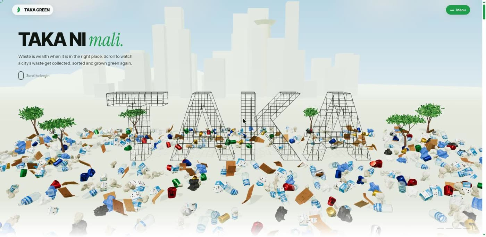
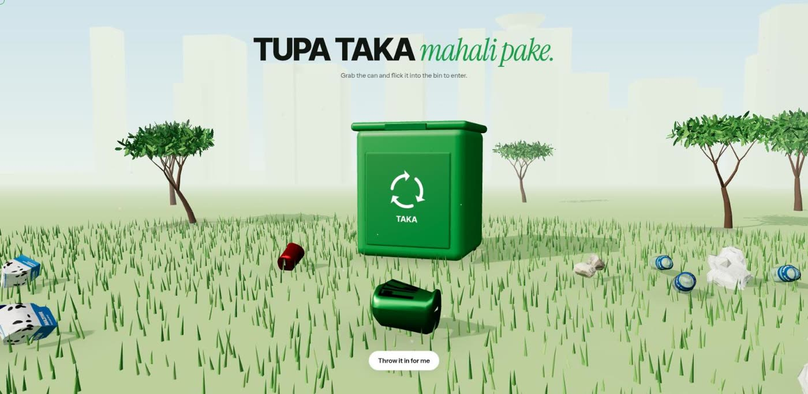
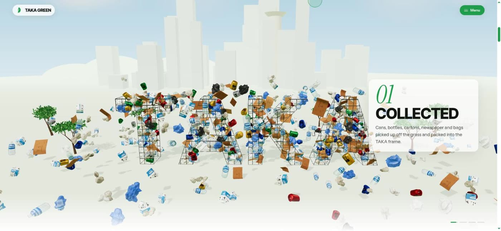
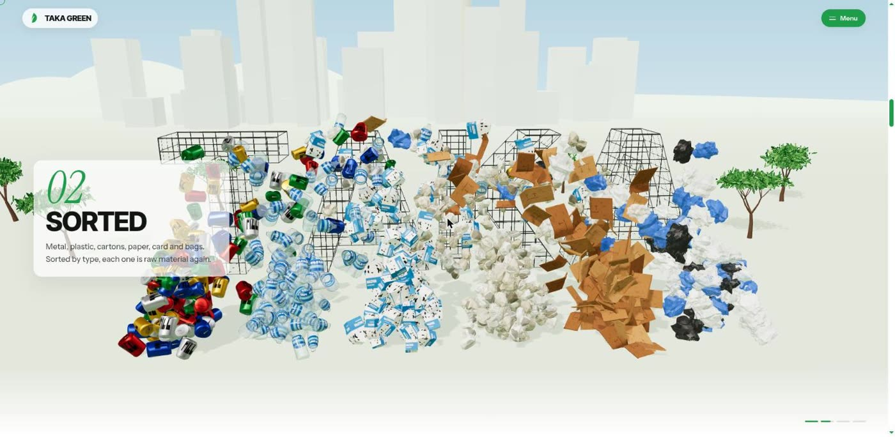
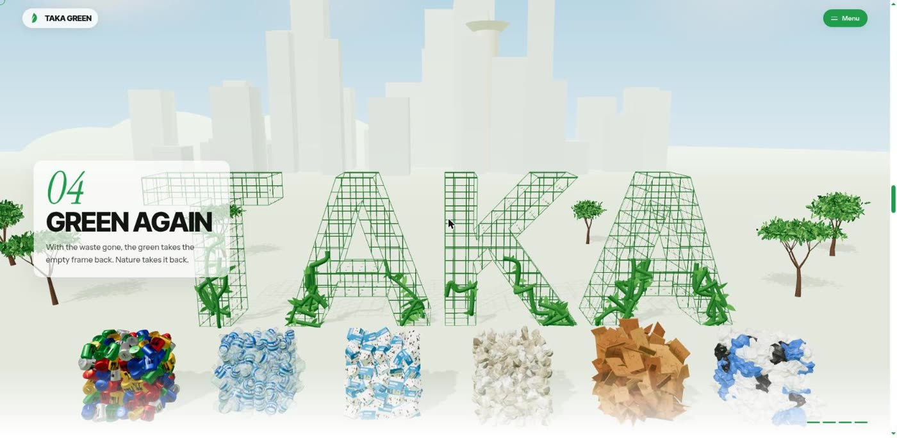
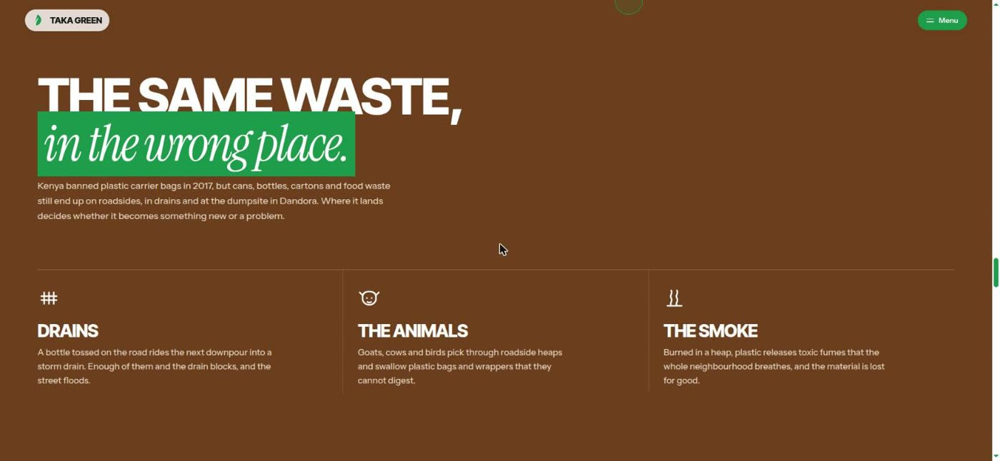
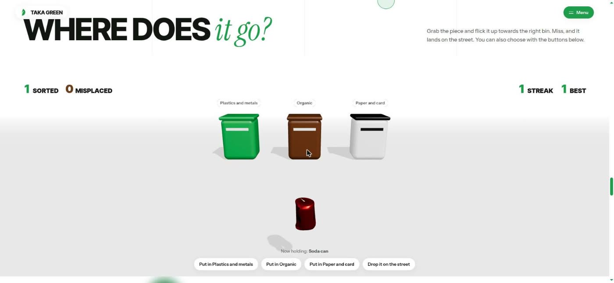
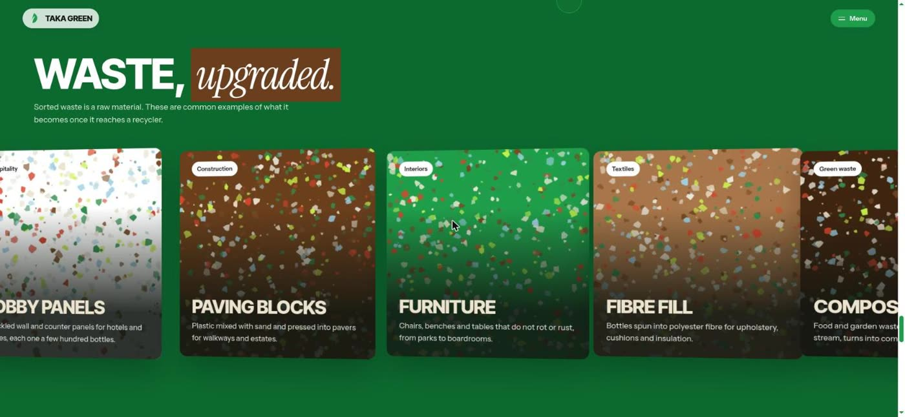
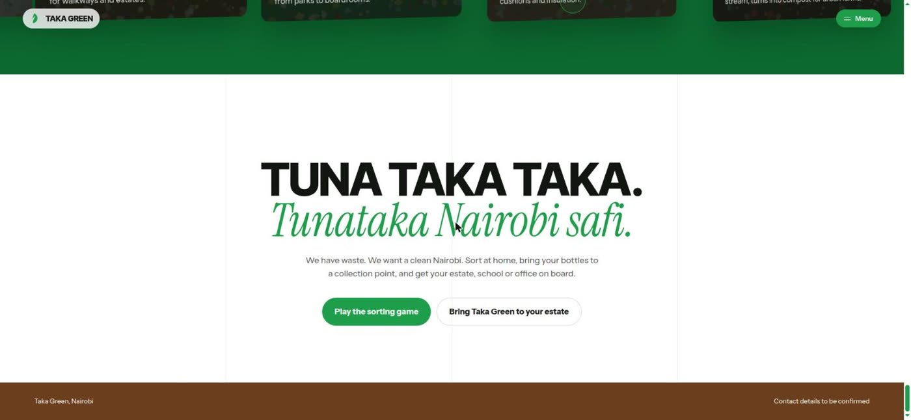
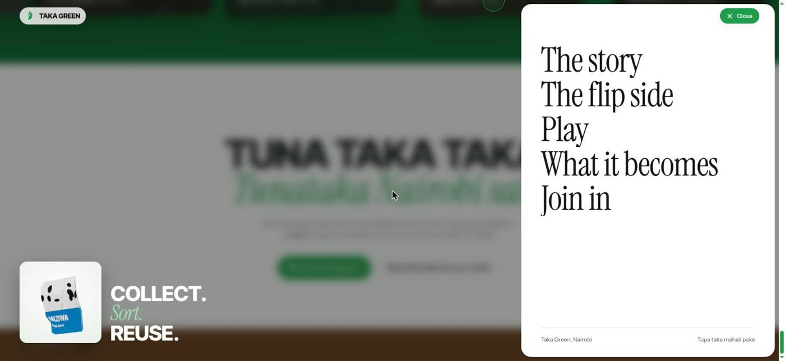

# Taka Green

**Tupa taka mahali pake.** Put waste in its place.

Taka Green is an interactive 3D website about environmental conservation and waste sensitisation in Nairobi. It shows, as you scroll, what happens to waste when it lands in the right place: it is collected, sorted, baled for recycling, and the green comes back. It also shows the flip side, and lets visitors practise sorting in a small 3D game.

**Live:** [taka-taka-iota.vercel.app](https://taka-taka-iota.vercel.app/)



---

## The experience

### 1. Entry: throw it in
The site opens on a patch of grass with a green wheelie bin. Visitors grab the can and flick it into the bin to enter, or press **Enter**, or tap **Throw it in for me**. The site opens out of the bin.



### 2. The story: from litter to green
One continuous 3D scene, driven by scroll. *Taka ni mali* means "waste is wealth".

| Stage | What happens |
| --- | --- |
| **Start** | Cans, PET bottles, milk cartons, newspaper, cardboard and plastic bags lie scattered on the grass among the trees, around empty steel letters spelling **TAKA**. |
| **01 Collected** | The litter lifts off the ground and packs into the TAKA frame. |
| **02 Sorted** | It pours out into one heap per material. |
| **03 Baled** | Each heap is pressed into a tight bale, ready for the recycler. |
| **04 Green again** | Vines climb the empty letters and the steel turns to moss. Nature takes it back. |

<p>
  
  
</p>



### 3. The flip side
A brown chapter, reached through a staircase wipe, on what waste does in the wrong place: blocked drains and floods, animals that swallow plastic, and toxic smoke from burning.



### 4. Where does it go? (the game)
Grab the piece and flick it at the right bin: **Plastics and metals**, **Organic**, or **Paper and card**. A miss lands on the street as litter. Items include a soda can, a PET bottle, a banana peel, a maize cob, newspaper, cardboard and a milk carton. Score, misplaced count, streak and best streak are tracked. Every action also has a button, for keyboard and screen reader users.



### 5. Waste, upgraded
A green chapter that bleeds in like ink, with a sideways-scrolling row of what sorted waste commonly becomes: lobby panels, paving blocks, furniture, fibre fill and compost. Each card has a terrazzo texture made from the waste colours.



### 6. Join in, and the menu
*Tuna taka taka. Tunataka Nairobi safi.* ("We have waste. We want a clean Nairobi.") The menu dims and blurs the page and grows a white panel from the corner, with a turning 3D milk carton beside it.

<p>
  
  
</p>

---

## How it is built

- **[Next.js 16](https://nextjs.org/)** (App Router) with React 19 and TypeScript, as a static site.
- **[React Three Fiber](https://r3f.docs.pmnd.rs/)**, **[drei](https://drei.docs.pmnd.rs/)** and **[three.js](https://threejs.org/)** for the 3D.
- **[GSAP](https://gsap.com/)** with ScrollTrigger for the scroll story and transitions, and **[Lenis](https://lenis.darkroom.engineering/)** for smooth scrolling.
- **Fonts:** Inter Tight (display), Instrument Serif (italic voice) and Instrument Sans (body), self-hosted through `next/font`.

Everything 3D is generated in code: no model files, no image downloads.

- **Trash** (`components/three/trash.ts`): crushed cans, PET bottles, gable-top Maziwa milk cartons, crumpled newspaper, folded cardboard and plastic bags. They're modelled with lathe and displaced geometry and textured with canvas-drawn labels and grime. Hundreds of pieces are drawn with instancing.
- **Trees** (`components/three/trees.ts`): procedural branching. A tapering trunk splits into branches and twigs, with thousands of individual leaf cards at the tips. There are two kinds, flat-crowned acacias and rounded broadleaf trees.
- **TAKA letters:** extruded from the three.js Helvetiker Bold font, with a wire-mesh alpha texture. Points inside the letter outlines are sampled to place the litter and grow the vines.
- **Setting:** the Nairobi skyline with the KICC tower, the Ngong Hills in the haze, soft clouds, and reflections from generated studio light rather than an HDR file.

### Project structure

```
app/
  layout.tsx          fonts and metadata
  page.tsx            the page: gate, header, story, flip side, game, uses, join in
  globals.css         palette, sections, gate, menu, transitions
components/
  Gate.tsx            entry scene: throw the can in the bin
  Header.tsx          logo, menu panel with the turning carton
  Story.tsx           pinned scroll story and its captions
  FlipSide.tsx        the problem chapter
  SortGame.tsx        game state, score, streaks, buttons
  Uses.tsx            horizontal "waste, upgraded" cards
  Pledge.tsx          closing call to action and footer
  Transitions.tsx     staircase wipe and ink wash
  Reveal.tsx          headline reveals
  SmoothScroll.tsx    Lenis + ScrollTrigger
  Cursor.tsx          ring cursor (mouse only)
  three/
    RecycleScene.tsx  the story scene: letters, trash, vines, park
    GameScene.tsx     the game scene: bins, items, throwing
    trash.ts          trash geometry and textures
    trees.ts          procedural trees
docs/screenshots/     the images in this README
```

## Running it

```bash
npm install
npm run dev        # http://localhost:3000
npm run build      # production build
npm run typecheck
```

The site deploys to Vercel with the default Next.js settings.

## Accessibility and performance

- With **reduced motion** turned on, smooth scrolling, headline reveals and section wipes are switched off.
- The game can be played entirely with buttons, and score changes are announced to screen readers.
- Each 3D scene only renders while it is on screen, and the device pixel ratio is capped.
- The custom cursor only appears on devices with a mouse.

## Content notes

- Factual claims are kept to the 2017 Kenyan plastic carrier bag ban and the Dandora dumpsite. The "Waste, upgraded" cards are labelled as common examples, not things Taka Green makes.
- The leaf logo, the contact line ("Contact details to be confirmed") and the "Bring Taka Green to your estate" link are placeholders until the real details are confirmed.
- Inspired by the *Tuna Taka Taka* bottle-cage billboard in Nairobi.
